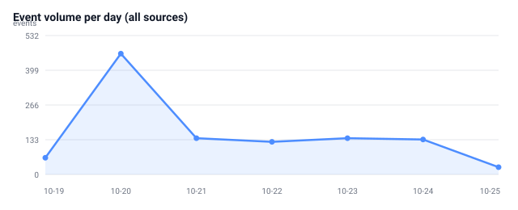
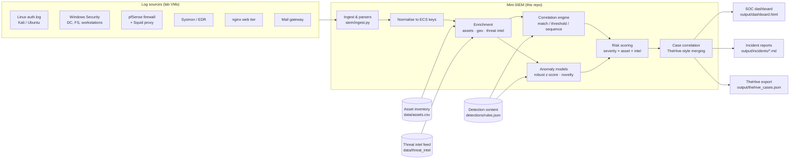

# Security Incident Detection and Analysis

A complete, runnable implementation of the **Enterprise Security Monitoring, Detection,
Investigation and Response** project: a mini-SIEM with multi-source log ingestion,
correlation rules, threat-intelligence enrichment, behavioural anomaly detection,
risk-based prioritisation, case management, an analyst dashboard, and generated
incident reports.

Everything runs on the Python standard library — no SIEM licence, no internet
connection, no external services. The same content is also expressed as Sigma,
Splunk SPL, Elastic KQL/EQL and Suricata rules so it can be lifted into a real
Splunk/ELK deployment.

```bash
python3 -m siem generate     # rebuild the seven-day simulated capture (data/logs)
python3 -m siem run          # ingest → detect → score → correlate → report
python3 -m siem serve        # http://localhost:8000 — open the SOC dashboard
python3 -m unittest discover -s tests
```

---

## Results at a glance (capture window 19–25 October 2026)

| Metric | Result |
|---|---|
| Events ingested / normalised | **1,092** from **7 sources** (100 % parse rate) |
| Detection content | **26 correlation rules + 3 anomaly models** |
| Alerts | **34 actionable**, 3 suppressed by documented allowlists (8.1 % noise reduction) |
| Incidents | **8** — 4 Critical, 2 High, 2 Medium |
| Mean time to detect (MTTD) | **3.3 min** |
| Mean time to acknowledge (MTTA) | **2.0 min** |
| Mean time to respond (MTTR) | **7.6 h** (median 4.6 h) |
| ATT&CK coverage | **27/27 techniques** and **29/29 rules** exercised by the scenario set |
| Incident types | Brute force, DDoS, reconnaissance, web attack, phishing, malware/C2, lateral movement, ransomware, data breach, insider threat |



| Incident register | |
|---|---|
| **INC-2026-0001** DDoS — 203.0.113.199 | High · P2 · 85/100 |
| **INC-2026-0002** Credential stuffing — 203.0.113.120 | Medium · P3 · 52/100 |
| **INC-2026-0003** Port scan — 198.51.100.23 | Medium · P3 · 62/100 |
| **INC-2026-0004** Web exploitation attempts — 198.51.100.23 | High · P2 · 85/100 |
| **INC-2026-0005** SSH brute force → root compromise — web-srv-02 | Critical · P1 · 100/100 |
| **INC-2026-0006** Phishing → malware → C2 → lateral movement → ransomware | Critical · P1 · 100/100 |
| **INC-2026-0007** Insider data exfiltration — ws-hr-07 → data-share-cloud.net | Critical · P1 · 100/100 |
| **INC-2026-0008** RDP password spray — jump-01 | Critical · P1 · 91/100 |

Full case files: [`output/incidents/`](output/incidents) · Executive summary:
[`output/EXECUTIVE_SUMMARY.md`](output/EXECUTIVE_SUMMARY.md) · Machine-readable metrics:
[`output/metrics.json`](output/metrics.json).

---

## Architecture



| Stage | Implementation | What it demonstrates |
|---|---|---|
| Ingestion | `siem/ingest.py` — 7 hand-written parsers | Log collection, parsing, field normalisation |
| Enrichment | `siem/assets.py`, `siem/intel.py` | Asset criticality, geo, IOC matching |
| Correlation | `siem/rules.py` | Threshold, distinct-count, sequence rules |
| Behavioural detection | `siem/anomaly.py` | Robust z-score baselines and first-seen novelty |
| Prioritisation | `siem/scoring.py` | Risk-based severity and P1–P4 prioritisation |
| Case management | `siem/incidents.py`, `siem/playbooks.py` | Alert correlation, MITRE mapping, NIST 800-61 response |
| Reporting | `siem/report.py`, `siem/dashboard.py` | Incident reports, dashboards, SOC metrics |

---

## What the lab simulates

The seven-day capture is generated deterministically by
[`scenarios/generator.py`](scenarios/generator.py) in the **native format** of each
source system (syslog, Windows Security CSV, pfSense CSV, Squid, Sysmon JSON,
nginx combined, mail-gateway JSON).

| Day | Scenario | Attacker | Expected detections |
|---|---|---|---|
| Oct 19 | Baseline business activity | — | none (false-positive control) |
| Oct 20 | HTTP flood + credential stuffing on the web tier | 203.0.113.199 / .120 | DET-012, DET-013 |
| Oct 21 | Port scan then web exploitation attempts | 198.51.100.23 | DET-010, DET-011 |
| Oct 22 | SSH brute force → root compromise and persistence | 203.0.113.44 | DET-001, DET-002, DET-035, DET-036, ANO-002 |
| Oct 23 | Phishing → macro → encoded PowerShell → C2 | secure-auth-portal.com, 192.0.2.77 | DET-020…DET-027, ANO-003 |
| Oct 24 | Lateral movement → shadow-copy deletion → ransomware | compromised ws-fin-14 | DET-030…DET-039 |
| Oct 25 | Insider exfiltration to a known exfil domain + RDP spray | m.singh / 203.0.113.44 | DET-034, DET-037, DET-038, ANO-001 |

Deliberate **false-positive traps** are included and handled by the tuning layer:
an authorised Nessus scan (`AL-001`), the nightly backup replication including one
weekly full backup (`AL-002`), a service account reading file shares at night
(`AL-003`), and administrator password typos that stay below the threshold.

---

## Detection content

| ID | Detection | Type | Severity | ATT&CK |
|---|---|---|---|---|
| DET-001 | SSH brute force (8 failures / 15 min) | threshold | High | T1110.001 |
| DET-002 | Successful SSH login after ≥5 failures | sequence | Critical | T1110.001, T1078.003 |
| DET-003 | Windows logon failure burst (10 / 10 min) | threshold | High | T1110.003 |
| DET-010 | Port scan (20 denies, ≥10 ports / 5 min) | threshold + distinct | Medium | T1046 |
| DET-011 | Web exploitation signatures | regex match | High | T1190 |
| DET-012 | HTTP flood (300 req / 5 min) | threshold | High | T1498.001 |
| DET-013 | Credential stuffing on /login | threshold | Medium | T1110.004 |
| DET-020 | Phishing from IOC domain | intel match | High | T1566.001 |
| DET-021 | Office application spawns PowerShell | process ancestry | Critical | T1204.002, T1059.001 |
| DET-022 | Encoded PowerShell command | regex match | High | T1059.001 |
| DET-023 | LSASS credential access | match | Critical | T1003.001 |
| DET-024 | Scheduled task persistence | regex match | High | T1053.005 |
| DET-025 | Registry run-key autorun | regex match | Medium | T1547.001 |
| DET-026 | Communication with known C2 | intel + category | Critical | T1071.001 |
| DET-027 | Known malware hash on endpoint | intel hash | Critical | T1204.002 |
| DET-030 | Shadow copy deletion | regex match | Critical | T1490 |
| DET-031 | Mass file encryption (100 files / 10 min) | threshold | Critical | T1486 |
| DET-032 | Suspicious service installation | regex match | High | T1543.003 |
| DET-033 | SMB lateral movement (3+ hosts / 10 min) | threshold + distinct | High | T1021.002 |
| DET-034 | Off-hours access to sensitive share | context match | Medium | T1530, T1078 |
| DET-035 | New local account on server | match | High | T1136.001 |
| DET-036 | Suspicious download/execution via sudo | regex match | High | T1105 |
| DET-037 | Bulk upload > 500 MB | threshold on field | High | T1041 |
| DET-038 | Upload to known exfiltration destination | intel match | Critical | T1567 |
| DET-039 | Audit log cleared | match | Critical | T1070.001 |
| DET-040 | Proxy denial burst | threshold | Medium | T1071.001 |
| ANO-001 | Outbound data-volume anomaly | robust z-score (median/MAD) | High | T1041 |
| ANO-002 | Authentication failure spike | robust z-score | High | T1110 |
| ANO-003 | First-seen process on endpoint | novelty model | Medium | T1204 |

Portable versions of the highest-value rules:
[`detections/sigma/`](detections/sigma), [`detections/splunk/searches.spl`](detections/splunk/searches.spl),
[`detections/elastic/kql.md`](detections/elastic/kql.md),
[`detections/suricata/local.rules`](detections/suricata/local.rules).

---

## Deliverables checklist (from the project brief)

| Required deliverable | Where it lives |
|---|---|
| Configured security environment | [`docs/02-lab-environment.md`](docs/02-lab-environment.md) — VirtualBox topology, forwarding configs, Suricata, TheHive |
| SIEM dashboard + screenshots | [`output/dashboard.html`](output/dashboard.html), chart evidence in [`output/visuals/`](output/visuals) |
| Alert screenshots / evidence | Dashboard **Alerts** tab; raw alerts in [`output/alerts.json`](output/alerts.json) |
| Log ingestion evidence | [`output/ingest_stats.json`](output/ingest_stats.json), [`data/logs/manifest.json`](data/logs/manifest.json) |
| Incident analysis reports | [`output/incidents/`](output/incidents) — 8 full case reports + register |
| Security incident documentation | [`docs/05-incident-response.md`](docs/05-incident-response.md), [`docs/08-findings-and-recommendations.md`](docs/08-findings-and-recommendations.md) |
| Visualisation outputs | [`output/visuals/*.svg`](output/visuals), dashboard charts, MITRE coverage |
| Case management evidence | [`output/thehive_cases.json`](output/thehive_cases.json) — TheHive-compatible export |
| Validation evidence | [`docs/09-validation-and-evidence.md`](docs/09-validation-and-evidence.md), 42 automated tests |

---

## Repository layout

```
siem/                mini-SIEM engine
  ingest.py          parsers + normalisation + enrichment
  rules.py           correlation engine (match / threshold / sequence)
  anomaly.py         robust z-score and novelty models
  scoring.py         risk-based severity
  incidents.py       case correlation, timeline, TheHive export
  playbooks.py       NIST 800-61 response playbooks
  report.py          Markdown incident reports
  dashboard.py       self-contained HTML dashboard
  metrics.py         SOC KPIs
  charts.py          dependency-free SVG charts
  pipeline.py, cli.py
scenarios/           deterministic attack simulation + log writer
detections/          rules.json, allowlists.json, Sigma/Splunk/Elastic/Suricata
data/                assets.csv, threat intel feed, generated logs
output/              generated evidence (dashboard, reports, metrics)
docs/                project documentation (11 chapters)
tests/               42 automated tests
```

## Documentation

| Document | Contents |
|---|---|
| [01 Architecture](docs/01-architecture.md) | Components, data flow, event schema, design trade-offs |
| [02 Lab environment](docs/02-lab-environment.md) | VirtualBox network, VMs, log forwarding, Suricata, TheHive/MISP |
| [03 Log sources & ingestion](docs/03-log-sources-and-ingestion.md) | Source formats, parsing, field mapping, ingest evidence |
| [04 Detection engineering](docs/04-detection-engineering.md) | Rule rationale, tuning, false-positive analysis, anomaly models |
| [05 Incident response](docs/05-incident-response.md) | Severity matrix, escalation, playbooks, evidence handling |
| [06 Threat intelligence](docs/06-threat-intelligence.md) | Feed schema, IOC lifecycle, integration points |
| [07 Metrics & reporting](docs/07-metrics-and-reporting.md) | KPI definitions, formulas, weekly results |
| [08 Findings & recommendations](docs/08-findings-and-recommendations.md) | Trend analysis, risk exposure, 30/60/90-day roadmap |
| [09 Validation & evidence](docs/09-validation-and-evidence.md) | Test matrix, evidence index, reproduction steps |
| [10 Tooling & prerequisites](docs/10-tooling-and-prerequisites.md) | Hardware, software, skills checklist |
| [11 Attack scenarios](docs/11-attack-scenarios.md) | Scenario catalogue mapped to expected detections |

## Design notes and honesty about scope

* **The environment is simulated, not virtualised.** A 12 GB VirtualBox estate cannot
  ship inside a Git repository, so the lab generates byte-accurate logs in each native
  format. Every parser is written against the real format, so the same code ingests
  genuine Splunk/ELK exports; see [docs/02](docs/02-lab-environment.md) for the VM build
  that produces them and [docs/03](docs/03-log-sources-and-ingestion.md) for the field
  mapping.
* **All timestamps, IPs and users are synthetic.** Documentation ranges
  (RFC 5737) and invented names are used throughout; no real personal data is present.
* **MTTA/MTTR are simulated analyst actions** with realistic offsets, because there is
  no live SOC on the other end of this pipeline. The measurement code is real.
* **The anomaly models are intentionally simple** (median + MAD, first-seen novelty) and
  their limitations are documented rather than hidden.
