# 01 — Architecture

## 1. Purpose

The project brief asks for an enterprise detection capability: collect telemetry,
detect incidents, classify and prioritise them, analyse impact, respond, document,
and recommend improvements. This repository implements that capability as a small,
auditable SIEM that runs anywhere Python 3.10+ is available.

The engine is intentionally *thin and explicit*: there is no framework, no database
and no external service. Every stage writes a JSON or Markdown artefact that a
reviewer can inspect, which is what makes the pipeline usable as project evidence.

## 2. Logical architecture

```mermaid
flowchart TB
    subgraph Collect["1 · Collect"]
        L1[Linux auth.log]
        L2[Windows Security CSV]
        L3[pfSense firewall CSV]
        L4[Squid proxy log]
        L5[Sysmon / EDR JSON]
        L6[nginx access log]
        L7[Mail gateway JSON]
    end

    subgraph Normalise["2 · Normalise & enrich"]
        N1[Parser per source]
        N2[Dotted ECS-style event]
        N3[Asset inventory<br/>criticality · classification]
        N4[Geo + internal/external]
        N5[Threat-intel matching]
        N6[Off-hours flag]
    end

    subgraph Detect["3 · Detect"]
        D1[Correlation rules<br/>match · threshold · distinct · sequence]
        D2[Anomaly models<br/>robust z-score · novelty]
        D3[Allowlist / suppression layer]
    end

    subgraph Decide["4 · Classify & prioritise"]
        P1[Risk score<br/>rule + asset + intel + volume]
        P2[Severity Low→Critical]
        P3[Incident correlation<br/>type · asset · identity · time]
    end

    subgraph Respond["5 · Respond & document"]
        R1[Playbook actions<br/>NIST 800-61]
        R2[Timeline reconstruction]
        R3[Root cause + impact]
        R4[Reports · dashboard · TheHive export]
    end

    Collect --> Normalise --> Detect --> Decide --> Respond
```



## 3. Pipeline stages

| # | Stage | Module | Input | Output |
|---|---|---|---|---|
| 1 | Discover & parse | `siem/ingest.py` | `data/logs/**` native formats | normalised events |
| 2 | Enrich | `siem/ingest.py`, `assets.py`, `intel.py` | events + asset register + IOC feed | context-rich events |
| 3 | Correlate | `siem/rules.py` | events + `detections/rules.json` | alerts |
| 4 | Behavioural detection | `siem/anomaly.py` | events + baselines | anomaly alerts |
| 5 | Score | `siem/scoring.py` | alerts + asset criticality + intel | risk score, severity |
| 6 | Tune | `siem/suppress.py` + `detections/allowlists.json` | alerts | actionable vs suppressed |
| 7 | Case correlation | `siem/incidents.py` | alerts | incidents with timeline |
| 8 | Measure | `siem/metrics.py` | events, alerts, incidents | SOC KPIs |
| 9 | Report | `siem/report.py`, `dashboard.py` | incidents, metrics | Markdown, HTML, SVG, JSON |

## 4. Event schema

Events are flat dictionaries with dotted ECS-inspired keys. Flat keys keep rule
matching, grouping and JSON output trivial while remaining familiar to analysts.

```json
{
  "event_id": "EVT-000431",
  "ts": "2026-10-23T09:34:00Z",
  "source": "edr",
  "event.category": "process",
  "event.action": "process_created",
  "event.outcome": "success",
  "event.off_hours": false,
  "host.name": "ws-fin-14.corp.local",
  "host.ip": "10.10.2.14",
  "host.criticality": "Critical",
  "host.role": "Finance Workstation",
  "host.data_classification": "Confidential",
  "user.name": "j.patel",
  "process.name": "powershell.exe",
  "process.command_line": "powershell.exe -nop -w hidden -enc SQBFAFgA...",
  "process.parent_name": "WINWORD.EXE",
  "intel.hit": true,
  "intel.matches": [{"type": "sha256", "value": "4d5e…", "threat_type": "Malware", "confidence": "high"}],
  "message": "process created powershell.exe",
  "raw": "{…original log line…}"
}
```

Design rules:

* `ts` is always UTC ISO-8601 with `Z`.
* `event.action` uses a closed vocabulary (`ssh_login_failed`, `windows_logon_success`,
  `firewall_deny`, `process_created`, …) so rules do not parse raw text.
* `raw` preserves the original line for evidence and re-parsing.
* `event.off_hours` is derived from a weekday 08:00–19:00 UTC business window.
* Fields are omitted when empty rather than set to `null`, keeping records small.

## 5. Detection architecture

Three ways to express a rule, all declarative JSON:

1. **match** — field equality/regex/intel on a group of events (one alert per group).
2. **threshold** — N events in a sliding window, optionally requiring K distinct
   values of another field, or a numeric field crossing a threshold.
3. **sequence** — ordered steps with per-step counts (e.g. 5 failures → 1 success).

Anomaly models are separate because they need a *baseline*, not a predicate:

| Model | Feature | Method | Alert condition |
|---|---|---|---|
| ANO-001 | outbound bytes per host per hour | robust z-score (median + MAD) | z ≥ 5 and volume ≥ 200 MB |
| ANO-002 | failed auths per source IP per hour | robust z-score | z ≥ 4 and count ≥ 8 |
| ANO-003 | first execution of a process per host | novelty against software baseline | any novel process |

Median + MAD is used instead of mean + standard deviation because the outlier we are
looking for would otherwise inflate the very baseline used to detect it. Where a host
or IP has fewer than three baseline buckets, the model falls back to peer/quiet
buckets and records `baseline_basis: "environment"` in the alert so an analyst can
judge confidence.

## 6. Prioritisation model

```
score = base_rule_severity            (Low 25, Medium 45, High 70, Critical 90)
      + asset criticality             (Low 0 … Critical 10)
      + threat-intel confidence       (low 3, medium 6, high 12, critical 16)
      + volume / corroboration        (0–6, or 4 for anomaly alerts)
      − low-confidence penalty        (−8 when rule confidence < 0.65)

severity = Critical ≥ 90 > High ≥ 70 > Medium ≥ 45 > Low
priority = P1 … P4
```

Incident risk adds a bounded corroboration bonus: `min(100, strongest alert + 2 per
extra distinct rule, max 8)`.

## 7. Case correlation rules

Alerts become cases when any of the following holds (evaluated chronologically):

| Rule | Condition | Example |
|---|---|---|
| Same type + entity | same `incident_type` and a shared entity, gap ≤ 48 h | 8 brute-force alerts |
| Serious + same asset | both High/Critical, shared asset, gap ≤ 24 h | recon → exploitation |
| Supporting alert | case already High/Critical, shared asset, alert ≥ Medium, gap ≤ 24 h | off-hours logon during ransomware |
| Same identity | shared user, gap ≤ 24 h, case already serious | phishing → malware on one user's host |

Cases are then linked into a campaign view when they share an asset or an external
origin IP within seven days (`related_incidents`).

## 8. Reliability and design trade-offs

| Decision | Why | Trade-off |
|---|---|---|
| No external dependencies | Runs on an air-gapped analyst laptop, reproducible in CI | No distributed search; in-memory processing |
| Flat dotted keys | Simple, fast matching, readable JSON | Not full ECS nesting |
| JSON rule pack | Reviewable in Git, testable, diffable | No visual rule editor |
| Sliding-window thresholds with cooldown | Prevents alert storms | May under-count very long bursts |
| Simulated analyst actions | Enables MTTA/MTTR measurement without a real SOC | MTTA/MTTR are modelled, not observed |
| Static self-contained dashboard | Works offline, screenshot-friendly, no build step | Not interactive drill-down beyond filters |

## 9. Performance notes

The engine is single-process and in-memory: 1,092 events flow through ingestion,
29 detections and case building in well under a second. Scaling to the 10⁶ events/day
of a real estate would require streaming ingestion and indexed windows; the rule
semantics (match/threshold/sequence) and the schema are deliberately chosen so they
translate directly onto Splunk correlation searches or Elastic detection rules.
