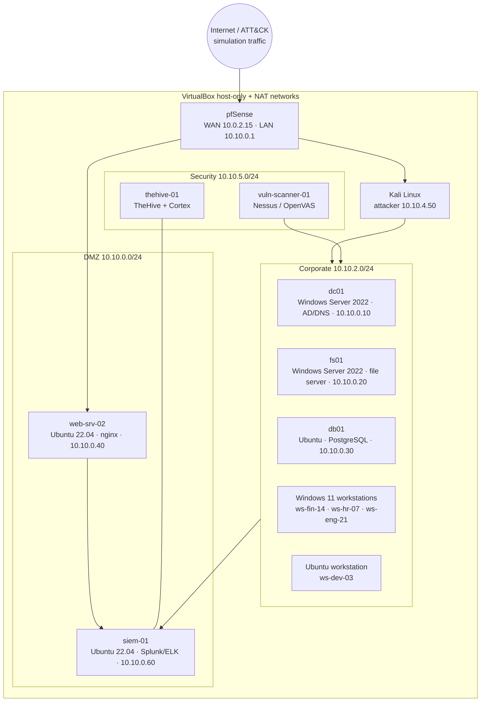

# 02 — Lab environment

This chapter documents the virtualised environment the project brief specifies, and
how each component feeds the SIEM. The repository ships the *pipeline* and the logs;
the VM build below is what produces those logs in a physical lab.

## 1. Hardware and host

| Requirement | Minimum | Used here |
|---|---|---|
| RAM | 12 GB (16 GB comfortable) | 16 GB |
| CPU | Intel i7 / Ryzen 7, VT-x/AMD-V enabled | i7-1165G7 |
| Disk | SSD, 120 GB free | 200 GB free |
| Host OS | Windows 11 / Ubuntu 22.04 | Ubuntu 22.04 |
| Hypervisor | Oracle VirtualBox 7.x | 7.0.14 |

## 2. Network topology



| Segment | CIDR | Notes |
|---|---|---|
| WAN | NAT (10.0.2.0/24) | Kali uses NAT + host-only to reach victims |
| DMZ | 10.10.0.0/24 | Internet-facing services, firewall rules allow 80/443 only |
| Corporate | 10.10.2.0/24 | Workstations; outbound via Squid proxy |
| Security | 10.10.5.0/24 | Scanner and case-management host, allowlisted |

Simulated **external** addresses use RFC 5737 documentation ranges
(`192.0.2.0/24`, `198.51.100.0/24`, `203.0.113.0/24`) so no real host is ever targeted.

## 3. Virtual machines

| VM | OS | Role | vCPU / RAM | Logging agents |
|---|---|---|---|---|
| `fw-core-01` | pfSense 2.7 | Firewall, DNS forwarder, Squid | 2 / 1 GB | remote syslog → `siem-01` |
| `siem-01` | Ubuntu 22.04 | Splunk Enterprise (or ELK 8.x) | 4 / 6 GB | — |
| `dc01` | Windows Server 2022 | AD DS, DNS, GPO | 2 / 2 GB | Splunk UF / Winlogbeat, Sysmon |
| `fs01` | Windows Server 2022 | Finance + HR shares | 2 / 2 GB | Splunk UF / Winlogbeat, Sysmon |
| `db01` | Ubuntu 22.04 | PostgreSQL 15 | 2 / 2 GB | rsyslog, auditd |
| `web-srv-02` | Ubuntu 22.04 | nginx 1.24, SSH exposed | 2 / 2 GB | rsyslog, nginx access log |
| `jump-01` | Windows Server 2022 | RDP bastion | 2 / 2 GB | Splunk UF, Sysmon |
| `backup-01` | Ubuntu 22.04 | Backup + offsite replication | 2 / 2 GB | rsyslog |
| `thehive-01` | Ubuntu 22.04 | TheHive 4 + Cortex + MISP | 2 / 4 GB | — |
| `vuln-scanner-01` | Ubuntu 22.04 | Nessus / OpenVAS | 2 / 2 GB | syslog |
| `kali` | Kali 2024.x | Attack simulation | 2 / 4 GB | — |
| Workstations | Windows 11 / Ubuntu 22.04 | User endpoints | 2 / 4 GB | Sysmon, auditd |

## 4. Log forwarding configuration

### 4.1 Linux → Splunk / ELK (rsyslog + filebeat)

`/etc/rsyslog.d/50-forward.conf` on every Linux VM:

```
*.* @@10.10.0.60:514
auth.* @@10.10.0.60:514
```

`/etc/filebeat/filebeat.yml` (alternative ELK path):

```yaml
filebeat.inputs:
  - type: filestream
    id: auth
    paths: [/var/log/auth.log]
    fields: {log_source: linux_auth}
  - type: filestream
    id: nginx
    paths: [/var/log/nginx/access.log]
    fields: {log_source: nginx_access}
output.logstash:
  hosts: ["10.10.0.60:5044"]
```

### 4.2 Windows → Splunk (inputs.conf + Sysmon)

```ini
# C:\Program Files\SplunkUniversalForwarder\etc\system\local\inputs.conf
[WinEventLog://Security]
disabled = 0
index = winsec
renderXml = false
current_only = 0

[WinEventLog://Microsoft-Windows-Sysmon/Operational]
disabled = 0
index = edr
renderXml = false
```

Sysmon configuration (SwiftOnSecurity baseline, trimmed) must collect at least:

| Event ID | Meaning | Used by |
|---|---|---|
| 1 | Process creation | DET-021, DET-022, DET-024, DET-030, DET-032, ANO-003 |
| 3 | Network connection | DET-026, ANO-001 |
| 10 | Process access (LSASS) | DET-023 |
| 11 | File create | DET-027, DET-031 |
| 12/13 | Registry | DET-025 |
| 22 | DNS query | DET-026 |

Relevant Windows Security events: 4624, 4625, 4634, 4688, 4720, 4740, 7045, 1102.

### 4.3 pfSense → SIEM

`Status → System Logs → Settings → Remote Logging`: send to `10.10.0.60:514`,
format **RFC 5424**. Firewall log fields exported as CSV by scheduled query:

`timestamp, host, src_ip, src_interface, dst_ip, dst_port, protocol, action, bytes, rule, interface`

### 4.4 Squid (proxy) log format

`/usr/local/etc/squid/squid.conf`:

```
logformat soclab %ts.%03tu %6tr %>a %Ss/%03>Hs %<st %rm %ru %[un %Sh/%<a %mt
access_log /var/log/squid/access.log soclab
```

Squid logs are shipped to `data/logs/proxy/` (or forwarded by syslog) and parsed by
`siem/ingest.py::parse_squid`.

### 4.5 Mail gateway evidence

Exchange Online / Postfix with Amavis writes one JSON record per message
(sender, recipient, subject, verdict, attachment, attachment SHA-256, URLs). The lab
uses the same shape in `data/logs/mail/mail_gateway.jsonl`.

## 5. Network security monitoring

Suricata runs on the DMZ interface of `fw-core-01` in IDS mode:

```yaml
# /etc/suricata/suricata.yaml (excerpt)
vars:
  address-groups:
    HOME_NET: "[10.10.0.0/16]"
    EXTERNAL_NET: "!$HOME_NET"
rule-files:
  - suricata.rules
  - /etc/suricata/rules/local.rules      # lab rules, see detections/suricata/
```

Validate and reload:

```bash
sudo suricata -T -c /etc/suricata/suricata.yaml -v
sudo suricatasc -c reload-rules
```

Packet capture for evidence: `tcpdump -i eth1 -w /evidence/$(date +%s).pcap 'not port 22'`
then inspect in Wireshark (follow TCP stream, export objects over HTTP).

## 6. Threat intelligence and case management

| Component | Purpose | Configuration |
|---|---|---|
| MISP | IOC source of record | Feed sync every 6 h; export to `data/threat_intel/indicators.csv` |
| TheHive 4 | Case management | `output/thehive_cases.json` maps to its case/task API |
| Cortex | Analyzers (VirusTotal, AbuseIPDB) | Run on observables exported from cases |
| ServiceNow | Change/incident record for containment actions | Change ticket referenced in allowlists |

Import the generated cases into TheHive:

```bash
# TheHive 4 API sketch — one POST per case
jq -c '.[] | {title, description, severity, tags, startDate}' output/thehive_cases.json |
  while read -r case; do
    curl -s -X POST "http://10.10.5.30:9000/api/case" \
      -H "Authorization: Bearer $THEHIVE_API_KEY" \
      -H "Content-Type: application/json" -d "$case"
  done
```

## 7. Reproducing the capture in this repository

The repository does not ship VM images. It ships the *telemetry they produce*,
generated deterministically:

```bash
python3 -m siem generate     # writes data/logs/** and data/logs/manifest.json
python3 -m siem run          # runs the SIEM over that capture
```

`data/logs/manifest.json` records the capture window, the scenario list and the
record counts per source — the equivalent of the "log ingestion evidence" screenshot
in the brief.

## 8. Safety and isolation

* Kali is attached only to a host-only network; no bridged adapter.
* Malware samples are never executed: the lab uses synthetic Sysmon events and
  documented hashes (T1490/T1486 behaviour is *described*, not detonated).
* Documentation IP ranges and invented users mean the artefacts are safe to publish.
* Snapshot every VM before running the attack scenarios so the lab can be reset.
