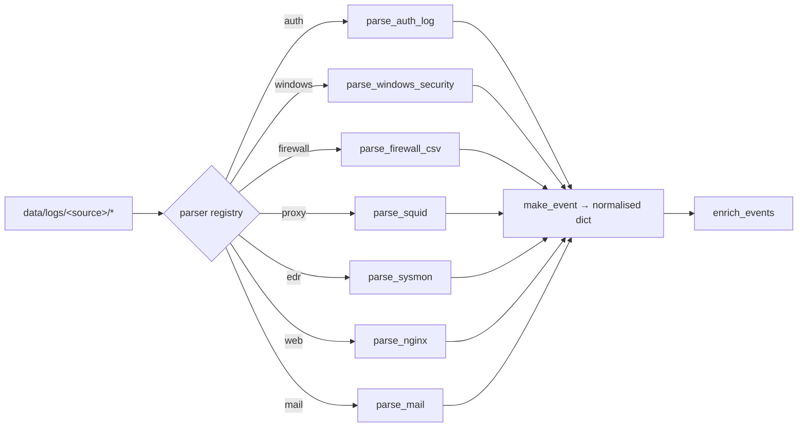

# 03 — Log sources and ingestion

## 1. Sources in scope

| # | Source | Native format | Volume (7 days) | Primary detections |
|---|---|---|---|---|
| 1 | Linux authentication (`auth.log`) | syslog | 71 | DET-001, DET-002, DET-035, DET-036 |
| 2 | Windows Security | CSV export of the event log | 52 | DET-003, DET-033, DET-034, DET-039 |
| 3 | pfSense firewall | CSV | 191 | DET-010, ANO-001 |
| 4 | Squid proxy | native access log | 118 | DET-037, DET-038, DET-040, ANO-001 |
| 5 | Sysmon / EDR | JSON lines | 203 | DET-021…DET-032, ANO-003 |
| 6 | nginx web tier | combined access log | 456 | DET-011, DET-012, DET-013 |
| 7 | Mail gateway | JSON lines | 1 | DET-020 |
| | **Total** | | **1,092** | |

Coverage of the brief's requirements:

| Required telemetry | Implemented as |
|---|---|
| Network traffic monitoring | pfSense flows + Suricata alerts + Squid |
| Endpoint activity | Sysmon process/file/registry/network events |
| Authentication logs | `auth.log` (sshd, sudo, useradd) and Windows 4624/4625 |
| System and application logs | Windows 7045/1102, sudo, cron, nginx |
| Unauthorised access attempts | DET-001/002/003/010/013 |
| Malware behaviour | DET-021…027, DET-030/031/032 |
| Data exfiltration indicators | DET-037/038, ANO-001 |
| Lateral movement | DET-033 |

## 2. Parsing

Each source has a dedicated parser in `siem/ingest.py`; the parser is selected by the
directory name under `data/logs/`.



Parsing rules of thumb:

* **Never trust the source's field names** — map them once, here.
* Preserve the raw line in `raw` for evidence.
* Reject or skip rows that are not security events (e.g. Windows machine accounts
  ending in `$`) instead of polluting behaviour baselines.
* Attach the *reporting device* to `observer.name` (the firewall) and the *affected
  endpoint* to `host.name` (the internal system). This distinction matters: the first
  version of the lab attributed every firewall flow to `fw-core-01`, which broke the
  outbound-volume baseline.

## 3. Field mapping

### 3.1 Linux `auth.log`

```
Oct 22 03:00:00 web-srv-02.corp.local sshd[4711]: Failed password for root from 203.0.113.44 port 44121 ssh2
```

| Extracted | Event field |
|---|---|
| `Oct 22 03:00:00` + lab year | `ts` |
| `web-srv-02.corp.local` | `host.name` (resolved to asset) |
| `sshd` + message | `event.category=authentication`, `event.action=ssh_login_failed` |
| `root` | `user.name` |
| `203.0.113.44`, `44121` | `source.ip`, `source.port` |

`sudo` lines map to `event.action=sudo_command` with the command in
`process.command_line`; `useradd` lines map to `account_created`.

### 3.2 Windows Security CSV

```
TimeCreated,Computer,EventID,SubjectUserName,TargetUserName,IpAddress,LogonType,ProcessName,CommandLine,Status,Message
2026-10-24T02:10:00Z,fs01.corp.local,4624,,j.patel,10.10.2.14,3,,,0x0,Network logon from finance workstation
```

| Event ID | `event.action` | Key fields |
|---|---|---|
| 4624 | `windows_logon_success` | `logon.type`, `source.ip`, `user.name` |
| 4625 | `windows_logon_failed` | `source.ip`, `user.name` |
| 4688 | `process_created` | `process.name`, `process.command_line` |
| 4720/4726/4740 | `account_created` / `_deleted` / `_locked` | `user.name` |
| 7045 | `service_installed` | `process.name`, `process.command_line` |
| 1102 | `audit_log_cleared` | `user.name` |

`DOMAIN\user` is normalised to `user`.

### 3.3 Firewall CSV

`timestamp, host, src_ip, src_interface, dst_ip, dst_port, protocol, action, bytes, rule, interface`
→ `event.category=network`, `event.action=firewall_allow|firewall_deny`,
`observer.name=fw-core-01`, endpoint in `host.name` (internal source, else internal
destination), `network.bytes`.

### 3.4 Squid

```
1792512000.123 45 10.10.2.7 TCP_MISS/200 4404019200 POST https://data-share-cloud.net/upload m.singh DIRECT/93.184.216.34 text/html
```

→ `event.category=web`, `event.action=http_request` (or `proxy_denied` for
`TCP_DENIED`), `url.full`, `dns.question.name` (registrable domain), `network.bytes`,
`user.name`. The internal client IP resolves to the workstation asset.

### 3.5 Sysmon / EDR JSON

| Event ID | `event.action` | Fields of interest |
|---|---|---|
| 1 | `process_created` | `process.name`, `process.command_line`, `process.parent_name` |
| 3 | `network_connection` | `destination.ip`, `destination.port`, `network.transport` |
| 10 | `process_access` | `process.target_name=lsass.exe`, `process.access_mask` |
| 11 | `file_created` | `file.path`, `file.hash_sha256` |
| 12/13 | `registry_*` | `registry.key`, `registry.value` |
| 22 | `dns_query` | `dns.question.name` |

### 3.6 nginx

Combined log format → `event.category=web`, `http.status`, `http.method`,
`url.full`, `http.user_agent`, `network.bytes`. The server host is `web-srv-02`
(observer); the client remains `source.ip`.

### 3.7 Mail gateway

`sender_domain` and `attachment_sha256` allow IOC matching on both the sender
infrastructure and the attachment, which is what makes DET-020 fire before the user
opens anything.

## 4. Enrichment

| Enrichment | Source | Fields added |
|---|---|---|
| Asset resolution | `data/assets.csv` | `host.ip`, `host.criticality`, `host.role`, `host.data_classification` |
| Identity → asset | asset owner column, mail recipient | `host.name` for user-centric events |
| Internal / external | `config.INTERNAL_NETWORKS` | `source.internal`, `destination.internal` |
| Geo / ASN | static table for documentation ranges | `source.geo` |
| Threat intel | `data/threat_intel/indicators.csv` | `intel.hit`, `intel.matches`, `intel.threat_type` |
| Business hours | weekday 08:00–19:00 UTC | `event.off_hours` |

## 5. Ingestion evidence

`output/ingest_stats.json` records, per file, the raw line count, parsed event count
and parse rate. Current run:

| Log file | Parser | Raw lines | Events | Parse rate |
|---|---|---:|---:|---:|
| `data/logs/auth/auth.log` | auth | 71 | 71 | 100 % |
| `data/logs/edr/sysmon.jsonl` | edr | 203 | 203 | 100 % |
| `data/logs/firewall/fw-core-01.csv` | firewall | 191 | 191 | 100 % |
| `data/logs/mail/mail_gateway.jsonl` | mail | 1 | 1 | 100 % |
| `data/logs/proxy/squid_access.log` | proxy | 118 | 118 | 100 % |
| `data/logs/web/web-srv-02_access.log` | web | 456 | 456 | 100 % |
| `data/logs/windows/*_security.csv` | windows | 52 | 52 | 100 % |

In a production deployment the equivalent evidence is Splunk's
`index=_internal source=*metrics.log` licence/ingest report or Elastic's
`GET _cat/indices?v` plus the Filebeat monitoring tab.

## 6. Known parsing limitations

* Syslog timestamps carry no year; the ingest layer pins them to the lab year
  (`config.LAB_YEAR`). A real deployment uses RFC 5424 timestamps or Splunk's
  `TZ`/`datetime.xml` settings.
* nginx combined logs have no response body, so upload volume is approximated from
  Squid; HTTPS payload contents are never visible without TLS inspection.
* Windows CSV is a flattened export. Production ingestion uses `renderXml=false`
  key/value extraction with the same field mapping.
* Binary/PCAP analysis is out of scope for the pipeline; it is documented as the
  Wireshark validation step in [02](02-lab-environment.md).
