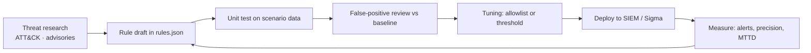

# 04 — Detection engineering

## 1. Rule lifecycle



Every rule in `detections/rules.json` carries: id, name, description, type,
severity, confidence, incident type, playbook, MITRE mapping, false-positive notes and
(where relevant) references. That metadata is what makes a rule maintainable six
months later.

## 2. Rule catalogue

| ID | Detection | Type | Severity | Conf. | ATT&CK | Tuning notes |
|---|---|---|---|---|---|---|
| DET-001 | SSH brute force | threshold 8 / 15 min | High | 0.85 | T1110.001 | Admin typos stay below 8; authorised scanners allowlisted |
| DET-002 | SSH success after failures | sequence (5 fails → success) | Critical | 0.90 | T1110.001, T1078.003 | Correlates, so a successful attack is unambiguous |
| DET-003 | Windows logon burst | threshold 10 / 10 min | High | 0.80 | T1110.003 | Service accounts with stale passwords are the main FP source |
| DET-010 | Port scan | threshold 20 / 5 min + ≥10 ports | Medium | 0.80 | T1046 | Requires *distinct ports* to avoid repeated retries on one port |
| DET-011 | Web exploitation | regex on URI | High | 0.75 | T1190 | QA/WAF test windows must be allowlisted |
| DET-012 | HTTP flood | threshold 300 / 5 min | High | 0.80 | T1498.001 | CDN health checks are low volume |
| DET-013 | Credential stuffing | threshold 40 401/403 / 10 min | Medium | 0.75 | T1110.004 | Load tests on `/login` cause FPs |
| DET-020 | Phishing from IOC domain | intel + email | High | 0.90 | T1566.001 | Requires a maintained feed |
| DET-021 | Office → PowerShell | process ancestry | Critical | 0.90 | T1204.002, T1059.001 | Signed ERP macros are the known FP |
| DET-022 | Encoded PowerShell | regex | High | 0.85 | T1059.001 | Some admin scripts use `-nop`; correlate with parent |
| DET-023 | LSASS access | process access mask | Critical | 0.90 | T1003.001 | AV/EDR processes must be filtered |
| DET-024 | Scheduled task | regex | High | 0.80 | T1053.005 | Software deployment tools create tasks |
| DET-025 | Run key autorun | registry path | Medium | 0.75 | T1547.001 | Installer noise; needs change context |
| DET-026 | Known C2 | intel + network | Critical | 0.90 | T1071.001 | IOC decay: expire old indicators |
| DET-027 | Malware hash | intel hash on endpoint | Critical | 0.95 | T1204.002 | Hash-only detection misses polymorphic samples |
| DET-030 | Shadow copy deletion | command line | Critical | 0.90 | T1490 | Backup tools that rotate VSS need an allowlist |
| DET-031 | Mass file encryption | threshold 100 / 10 min | Critical | 0.85 | T1486 | Legitimate bulk jobs (archive, migration) must be excluded |
| DET-032 | Suspicious service install | regex on path | High | 0.80 | T1543.003 | Monitoring agents install services from Program Files |
| DET-033 | SMB lateral movement | threshold 3 distinct hosts / 10 min | High | 0.75 | T1021.002 | Vulnerability scanners and backup jobs cause FPs |
| DET-034 | Off-hours sensitive share access | context match | Medium | 0.70 | T1530, T1078 | Service accounts allowlisted (AL-003) |
| DET-035 | New local account | account_created | High | 0.85 | T1136.001 | CM automation must be allowlisted |
| DET-036 | Download/exec via sudo | regex | High | 0.80 | T1105 | Package management looks similar; scope to wget/curl + shell pipes |
| DET-037 | Bulk upload | numeric threshold ≥ 500 MB | High | 0.75 | T1041 | Backup replication allowlisted (AL-002) |
| DET-038 | Upload to exfil destination | intel | Critical | 0.90 | T1567 | Depends on feed quality |
| DET-039 | Audit log cleared | 1102 | Critical | 0.90 | T1070.001 | Almost never legitimate outside change windows |
| DET-040 | Proxy denial burst | threshold 50 / 10 min | Medium | 0.70 | T1071.001 | Misconfigured clients are the usual cause |
| ANO-001 | Outbound volume anomaly | robust z ≥ 5, ≥ 200 MB | High | 0.60 | T1041 | Needs ≥ 3 baseline buckets; backup allowlisted |
| ANO-002 | Auth failure spike | robust z ≥ 4, ≥ 8 | High | 0.60 | T1110 | Catches low-and-slow below DET-001's window |
| ANO-003 | First-seen process | novelty | Medium | 0.55 | T1204 | Noisy on developer hosts (AL-004) |

## 3. Detection logic examples

### Threshold with distinct cardinality (DET-010)

```json
{
  "match": {"event.action": ["firewall_deny"]},
  "group_by": ["source.ip"],
  "count": 20,
  "window_seconds": 300,
  "distinct": {"field": "destination.port", "min": 10}
}
```

Why distinct? A client retrying port 443 fifty times is a misconfiguration; a client
touching twenty ports in five minutes is discovery.

### Sequence (DET-002)

```json
{
  "type": "sequence",
  "group_by": ["source.ip"],
  "window_seconds": 1800,
  "steps": [
    {"match": {"event.action": ["ssh_login_failed"]}, "count": 5, "label": "Repeated SSH authentication failures"},
    {"match": {"event.action": ["ssh_login_success"]}, "count": 1, "label": "Successful SSH authentication"}
  ]
}
```

Sequence rules are how a SIEM converts noise into a high-confidence statement:
"this source failed five times and then succeeded".

### Numeric field threshold (DET-037)

```json
{
  "match": {"source": ["proxy"], "http.method": ["POST", "PUT"]},
  "threshold_field": "network.bytes",
  "threshold_value": 500000000,
  "threshold_operator": ">="
}
```

## 4. False-positive analysis and tuning

### 4.1 Deliberate traps in the lab

| Trap | Effect without tuning | Control |
|---|---|---|
| Authorised Nessus scan from 10.10.5.20 (40 denies, 10 ports) | DET-010 alert | `AL-001` — scanner allowlist with change ticket and expiry |
| Weekly full backup (6.3 GB vs 1.7 GB median) | ANO-001 alert | `AL-002` — host allowlist |
| `svc_backup` reading HR share at 02:30 | DET-034 alert | `AL-003` — service-account allowlist |
| Administrator mistyping a password twice | none | threshold design (below 8) |
| Developer compiling ad-hoc tools | ANO-003 noise | `AL-004` — host allowlist |

Result: **37 candidate alerts → 34 actionable** (8.1 % noise reduction) with **zero
remaining false positives** in the capture window. The suppressed alerts are stored in
`output/suppressed_alerts.json` with the justification, owner, ticket and expiry date —
suppression is never silent.

### 4.2 Governance rules for allowlists

1. Every entry needs an **owner**, **ticket** and **expiry date** (enforced by schema).
2. Allowlists match the narrowest possible scope: one rule × one source/host/user.
3. Expired entries must be removed or re-approved; the dashboard lists them.
4. Suppressed alerts are still generated, scored and retained — they are evidence.

## 5. Anomaly detection

### 5.1 Robust z-score

```python
med = median(values)
mad = median(|value - med|)
sigma = 1.4826 * mad          # MAD → Gaussian-equivalent sigma
score = (observed - med) / sigma
alert if score >= threshold and observed >= min_value
```

Why median/MAD: with mean/σ the ransomware exfiltration (4.1 GB in one hour) alone
would raise the mean of ws-hr-07's baseline enough to hide itself. Median/MAD is
resistant to up to ~50 % contamination.

Baseline policy:

| Condition | Baseline used | Recorded as |
|---|---|---|
| ≥ 3 buckets for the host/IP | its own quiet buckets | `basis: host` / `source` |
| < 3 buckets | peer buckets (leave-one-out) | `basis: environment` |

### 5.2 First-seen process (novelty)

Compares `process_created` events per host against
`detections/baseline_processes.json` (a 30-day software inventory) and against
processes already seen on that host during the capture. It catches renamed or
packed binaries that no signature knows yet — `invoice_2026.exe` and `svc.exe` in
this capture — at the cost of noise on developer machines.

### 5.3 Model limitations (documented, not hidden)

* Small baselines (7 days) make per-entity statistics unstable; peer fallback masks
  attacker traffic in the environment pool (visible here: the external scanner's six
  SSH probes lift the environment median).
* Volume anomalies cannot separate exfiltration from an unapproved backup job; asset
  classification and allowlists are required.
* Novelty detection has no notion of *why* a process is new.

Roadmap: replace with per-entity seasonal models and a supervised classifier once six
months of labelled data exist.

## 6. Portability

| Format | File | Notes |
|---|---|---|
| Native JSON rule pack | `detections/rules.json` | Reference implementation |
| Sigma | `detections/sigma/*.yml` | Portable to Splunk, Elastic, Sentinel, Chronicle |
| Splunk SPL | `detections/splunk/searches.spl` | Includes lookups and threshold commands |
| Elastic KQL / EQL | `detections/elastic/kql.md` | Sequence detection in EQL |
| Suricata | `detections/suricata/local.rules` | Network-layer equivalents |

## 7. Testing

`tests/test_detection.py` asserts, per rule, that it fires on the attacking scenario
and does not fire on the benign baseline. A new rule is only "done" when it has:

1. a scenario that must trigger it,
2. a benign control that must not,
3. documented false-positive notes and a tuning path,
4. an ATT&CK mapping and a playbook link.

Current suite: **42 tests**, all passing, full rule coverage (29/29 rules exercised).
