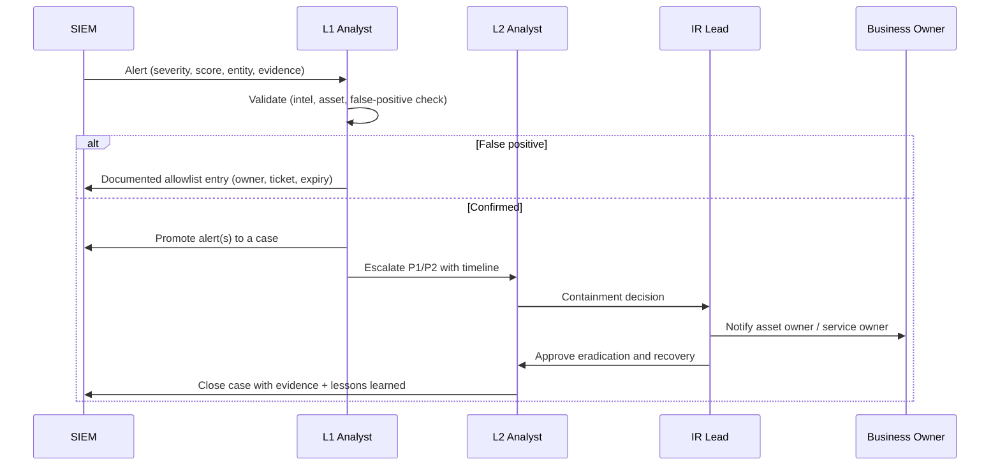

# 05 — Incident response

## 1. Framework

The lab follows **NIST SP 800-61r2** phases, mapped onto the pipeline:

| Phase | In the pipeline | Artefact |
|---|---|---|
| Preparation | Asset inventory, log sources, detection content, allowlists | `data/assets.csv`, `detections/` |
| Detection & analysis | Correlation rules, anomaly models, enrichment, case correlation | `output/alerts.json`, case files |
| Containment, eradication, recovery | Playbook actions with owners and offsets | `siem/playbooks.py`, case timeline |
| Post-incident activity | Root cause, impact, lessons learned, recommendations | `output/incidents/*.md` §4–§9 |

## 2. Severity and priority matrix

| Score | Severity | Priority | Response target | Escalation |
|---|---|---|---|---|
| ≥ 90 | Critical | P1 | 15 min to acknowledge, 1 h to contain | IR lead + CISO + asset owner, major-incident bridge |
| 70–89 | High | P2 | 30 min to acknowledge, 4 h to contain | IR lead + asset owner |
| 45–69 | Medium | P3 | 4 h to acknowledge, 24 h to contain | L2 analyst |
| < 45 | Low | P4 | Next business day | L1 queue |

Factors that raise the score: asset criticality (tier-0 = +10), threat-intel
confidence (+12 high, +16 critical), volume (+6 max), corroboration across rules
(+2 per extra rule, max 8). Factors that lower it: behavioural-only detections
(below 0.65 confidence, −8).

## 3. Escalation flow

## 4. Playbooks

Twelve playbooks live in `siem/playbooks.py`, each with NIST phases, an owner and a
realistic offset from triage. Example — `PB-RANSOMWARE`:

| Offset | Phase | Action | Owner |
|---|---|---|---|
| +2 min | Detection | Declare major incident; notify IR lead and CISO on-call | analyst.l1 |
| +3 min | Containment | Disable network ports on affected segments and isolate `fs01` | analyst.l2 |
| +8 min | Containment | Disable compromised accounts and revoke Kerberos tickets | analyst.l2 |
| +15 min | Analysis | Determine patient-zero, encryption scope and backup integrity | ir.lead |
| +45 min | Eradication | Rebuild affected servers from known-good images | it-ops |
| +120 min | Recovery | Restore data from immutable backups in a validated sequence | it-ops |
| +480 min | Post-Incident | Forensic report, regulator/legal assessment, resilience improvements | ir.lead |

The other playbooks: `PB-BRUTE-FORCE`, `PB-RECON`, `PB-WEB-ATTACK`, `PB-DDOS`,
`PB-PHISHING`, `PB-MALWARE`, `PB-C2`, `PB-DATA-BREACH`, `PB-INSIDER`,
`PB-LATERAL-MOVEMENT`, `PB-DEFAULT`. When a case contains several detection types the
actions are merged, de-duplicated and ordered.

**Timing model.** Triage starts at the *first* alert; the rest of the playbook starts
when the case scope is known (the last alert in the case). This prevents the
unrealistic situation where "containment" is timestamped before the malware alert that
motivated it.

## 5. Evidence handling

| Requirement | Implementation |
|---|---|
| Chain of custody | Every alert keeps `event_ids` and the original `raw` line |
| Reproducibility | Logs are deterministic (`scenarios/generator.py`, seed 20261031) |
| Integrity | Cases record the exact rule/alert IDs used to reach the conclusion |
| Retention | `output/` artefacts are regenerable; case reports are committed |
| Privacy | Only synthetic data; no real personal data in any artefact |

Evidence pack per case:

* `output/incidents/INC-XXXX.md` — full narrative report
* `output/alerts.json` — machine-readable alerts with event IDs
* `output/events.jsonl` — normalised telemetry (regenerable)
* `output/thehive_cases.json` — case record, tasks and observables
* `output/visuals/*.svg` — charts used in the report and dashboard

## 6. Communication templates

**Major incident notification (P1)**

> **Major incident declared — INC-2026-0006 (Confidential, TLP:AMBER)**
> At 09:12 UTC a phishing email delivered a macro-enabled document to a Finance
> workstation. The document executed an encoded PowerShell downloader that beaconed to
> known C2 infrastructure at 09:35. By 02:15 the next day the attacker had moved
> laterally to the file server and begun encryption.
> Impact: finance and HR file shares unavailable; no confirmed data loss yet;
> backups verified intact.
> Actions: affected hosts isolated, C2 blocked at egress, credentials rotated,
> restore in progress.
> Next update: 60 minutes. Bridge: SOC major-incident channel.

**Case closure note**

> Root cause: macro execution from a phishing attachment; no egress allow-listing and
> no ASR rule prevented the downloader.
> Detection: DET-020 → DET-021/022 → DET-026 → DET-033/030/031, MTTD 3 min.
> Response: isolation at T+3 min, egress block at T+10, restore completed at T+18 h.
> Preventive actions: ASR block, egress allow-list, MFA, immutable backup validation.

## 7. What "good" looks like

| Metric | Target | This capture |
|---|---|---|
| MTTD (critical) | < 15 min | 2–9 min |
| MTTA | < 15 min | 2 min |
| MTTR (critical) | < 8 h | 6.3–25 h depending on scope |
| False-positive rate | < 20 % | 0 % remaining after tuning (8.1 % suppressed) |
| Critical-case documentation | 100 % within 24 h | 100 % (generated with the case) |
