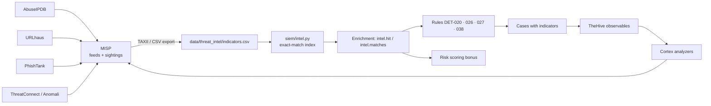

# 06 — Threat intelligence

## 1. Role in the pipeline

Threat intelligence turns an IP address or a file hash into *context*: known
brute-force source, C2 infrastructure, exfiltration destination, ransomware sample.
In this lab it does three things:

1. **Detection** — IOC match rules DET-020, DET-026, DET-027, DET-038.
2. **Escalation** — a high-confidence match adds +12 (or +16 for critical) to the risk
   score and often lifts an alert from High to Critical.
3. **Case context** — the case report lists indicators and their feed, confidence,
   first/last seen and description.

## 2. Feed schema

`data/threat_intel/indicators.csv`:

| Column | Example | Notes |
|---|---|---|
| `type` | `ip`, `domain`, `sha256` | Matched against `source.ip`, `destination.ip`, `dns.question.name`, `url.full`, `file.hash_sha256`, `email.sender` |
| `value` | `192.0.2.77` | Normalised to lowercase |
| `threat_type` | `Command and Control` | Drives which rule may fire |
| `confidence` | `high` / `medium` / `critical` | Drives the scoring bonus |
| `source` | MISP, AbuseIPDB, URLhaus, ThreatConnect, Anomali | Provenance for the report |
| `first_seen`, `last_seen` | `2026-10-12` | Decay and ageing |
| `tags` | `c2,cobalt-strike` | Analyst pivots |
| `description` | free text | Shown in reports |

## 3. Indicators used in this capture

| Type | Indicator | Threat type | Confidence | Source | Effect |
|---|---|---|---|---|---|
| IP | 203.0.113.44 | Brute Force | high | AbuseIPDB | Escalates DET-001/002/003 and ANO-002 |
| IP | 198.51.100.23 | Reconnaissance | high | OTX | Confirms scanning and exploit attempts |
| IP | 192.0.2.77 | Command and Control | high | MISP | Drives DET-026 |
| IP | 203.0.113.199 | Denial of Service | medium | Anomali | Confirms DDoS source |
| Domain | cdn-update-sync.com | Malware | high | URLhaus | DET-026 (DNS and proxy denials) |
| Domain | data-share-cloud.net | Data Exfiltration | high | MISP | DET-038 |
| Domain | secure-auth-portal.com | Phishing | high | PhishTank | DET-020 |
| SHA-256 | `8f14e45f…` | Ransomware | critical | ThreatConnect | DET-027 on fs01 |
| SHA-256 | `4d5e6f7a…` | Malware | high | ThreatConnect | DET-027 on ws-fin-14 |

## 4. Integration architecture



The feedback loop matters: observables from a closed case are re-checked in Cortex and
new confirmations are written back to MISP as sightings.

## 5. IOC lifecycle and governance

| Stage | Practice |
|---|---|
| Ingestion | Pull every 6 h; validate type and value; drop malformed rows |
| Normalisation | Lowercase domains, resolve registrable domain for URL matches |
| Confidence | Keep source confidence; never promote to `critical` without a second source |
| Ageing | `last_seen` older than 90 days → archive; 30 days → lower confidence |
| False positives | Shared infrastructure (CDNs, cloud ranges) must never be listed as IPs |
| Privacy | No internal indicators in the external feed; internal IOCs go to a private list |
| Retention | Keep the previous feed version for case reproducibility |

Known blind spot in this lab: hash-only malware detection (DET-027) misses
polymorphic samples, and the model cannot evaluate JA3 fingerprints or certificate
reputation. Both are documented as roadmap items.

## 6. Using intel without over-blocking

An IOC match is **evidence**, not a verdict. The lab's rules require a behavioural
correlate as well:

| Rule | Behavioural requirement |
|---|---|
| DET-020 | Must be an inbound email event |
| DET-026 | Must be network/web telemetry |
| DET-027 | Must be endpoint telemetry (`source in edr/windows`) |
| DET-038 | Must be outbound HTTP from a proxy event |

This avoids the classic failure mode where a shared hosting IP generates hundreds of
alerts because one domain on it was once malicious.

## 7. Extending to STIX/TAXII

`siem/intel.py` exposes `ThreatIntel.lookup(type, value)` and
`ThreatIntel.match_event(event)`. Replacing `load_feed()` with a TAXII 2.1 client that
emits the same `Indicator` objects requires no change to the detection engine:

```python
def load_from_taxii(url, collection_id, token):
    # GET /taxii2/collections/{id}/objects?match[type]=indicator
    # map STIX pattern → Indicator(type, value, threat_type=labels[0], ...)
    ...
```

## 8. Metrics to track

| Metric | Definition | Target |
|---|---|---|
| IOC hit rate | alerts with ≥ 1 IOC / actionable alerts | 25–40 % |
| False-positive IOC rate | IOC matches judged benign / all matches | < 5 % |
| Feed freshness | median age of indicators at match time | < 30 days |
| Coverage | ATT&CK techniques with an intel-backed detection | growing |
