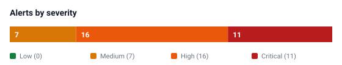
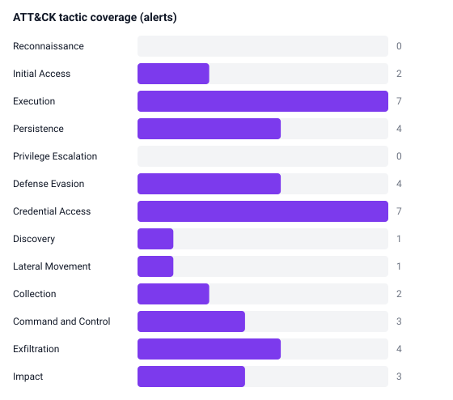

# 07 — Metrics, reporting and dashboards

## 1. KPI definitions

| KPI | Definition | Computed in |
|---|---|---|
| **MTTD** | first malicious event in the case → first alert | `incidents.mttd_minutes` |
| **MTTA** | first alert → first analyst action (triage) | `incidents.mtta_minutes` |
| **MTTR** | first malicious event → case closed (recovery validated) | `incidents.mttr_minutes` |
| Alert volume | actionable alerts per period | `metrics.detections.actionable_alerts` |
| Noise reduction | suppressed / (suppressed + actionable) | `metrics.detections.suppression_rate` |
| Alert-to-incident ratio | actionable alerts / incidents | `metrics` |
| Rule utilisation | rules that fired / rules defined | `metrics.coverage.rule_utilisation_pct` |
| Technique coverage | distinct ATT&CK techniques detected / defined | `metrics.coverage` |
| Detection lag | alert timestamp − last contributing event | implicit in case timeline |

MTTD is measured from the **first malicious event**, not from the first alert, which
prevents the metric from flattering a SIEM that simply alerts late on a long campaign.

## 2. Current results (19–25 October 2026)

| Metric | Value |
|---|---|
| Events ingested | 1,092 (7 sources, 100 % parse rate) |
| Candidate alerts | 37 |
| Actionable alerts | 34 |
| Suppressed alerts | 3 (8.1 %) |
| Incidents | 8 (4 Critical, 2 High, 2 Medium) |
| Mean / median MTTD | 3.3 min / 2.8 min (max 9.0 min) |
| Mean MTTA | 2.0 min |
| Mean / median MTTR | 7.6 h / 4.6 h |
| Rule utilisation | 29/29 (100 %) |
| ATT&CK techniques | 27/27 (11 tactics) |
| IOC-backed alerts | 24 of 34 |

### Alerts by severity

| Critical | High | Medium | Low |
|---:|---:|---:|---:|
| 11 | 16 | 7 | 0 |

### Alerts by incident type (contributing)

| Type | Alerts | Type | Alerts |
|---|---:|---|---:|
| Malware | 13 | DDoS | 1 |
| Brute Force | 6 | Phishing | 1 |
| Data Breach | 4 | Lateral Movement | 1 |
| Ransomware | 2 | Persistence | 1 |
| Insider Threat | 2 | Defense Evasion | 1 |
| Reconnaissance | 1 | Web Attack | 1 |

## 3. Visual outputs

Generated by `siem/charts.py` into `output/visuals/` and embedded in
`output/dashboard.html`:

| Chart | File | Question it answers |
|---|---|---|
| Event volume per day | `events-per-day.svg` | Is collection stable? Any gaps? |
| Alerts by severity | `alerts-by-severity.svg` | Is the queue manageable? |
| Incidents by type | `incidents-by-type.svg` | What attacks are we facing? |
| Alerts by rule | `top-detection-rules.svg` | Which rules carry the load? |
| ATT&CK tactics | `mitre-tactics.svg` | Where is our visibility? |





## 4. Dashboard

`output/dashboard.html` is a single self-contained page (no CDN, no build step).
Tabs:

| Tab | Contents |
|---|---|
| Overview | Six KPIs, four charts, incident register, tactic coverage |
| Incidents | Every case with summary, root cause, alerts, timeline, recommendations |
| Alerts | Filterable alert table (severity chips + free-text search), suppression evidence |
| Detection coverage | Rule-by-rule table: alerts, suppressed, techniques, exercised |
| Threat intelligence | Full IOC feed and which indicators produced alerts |
| Data quality & tuning | Ingest table, anomaly baselines, allowlist governance |

Serve it locally:

```bash
python3 -m siem serve --port 8000
# http://localhost:8000/
```

## 5. Report pack

| Artefact | Audience | Content |
|---|---|---|
| `output/incidents/INC-*.md` | IR, auditors | 9-section case report (summary, detection, timeline, root cause, impact, response, evidence, recommendations, lessons) |
| `output/incidents/INDEX.md` | SOC manager | Case register + aggregate metrics |
| `output/EXECUTIVE_SUMMARY.md` | CISO, business | Headline, KPIs, cases, priority recommendations |
| `output/metrics.json` | Automation, BI | Every number used above |
| `output/thehive_cases.json` | SOC platform | Cases, tasks, observables for import |
| `output/run_manifest.json` | Reproducibility | What was generated and when |

## 6. Reporting cadence

| Report | Frequency | Owner | Content |
|---|---|---|---|
| Shift handover | Per shift | L1 | Open cases, P1/P2 status, suppressions added |
| Daily SOC summary | Daily | L2 | Alert/incident counts, MTTD/MTTR trend |
| Weekly operations review | Weekly | IR lead | This document's §2–§4 + lessons learned |
| Monthly detection review | Monthly | Detection engineering | Rule precision, unused rules, ATT&CK gaps |
| Quarterly executive report | Quarterly | CISO | Risk exposure, trend, roadmap progress |

## 7. How to read the trend

* **Alert volume is not success.** The DDoS day produces 463 events and 1 incident;
  the quiet insider day produces 28 events and 1 Critical incident.
* **Watch the suppression rate, not just the false-positive count.** A rising rate can
  mean either good tuning or creeping blindness; that is why every entry has an owner
  and an expiry date.
* **Rule utilisation is a leading indicator.** A rule that never fires in a month is
  either mis-scoped or the threat is absent — check both.
* **MTTR dominated by scope, not detection.** In this capture detection takes minutes
  and recovery takes hours; investment should go into automation of containment, not
  more alerts.
