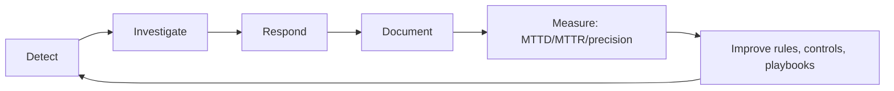

# 08 — Findings and recommendations

## 1. Executive findings

Eight incidents were detected across seven days. Two were material:

1. **Phishing-led intrusion ending in ransomware** (`INC-2026-0006`). A finance user
   opened a macro document, which executed encoded PowerShell and beaconed to known
   C2 infrastructure. The attacker then used harvested credentials to reach the file
   server, deleted volume shadow copies and encrypted finance shares.
2. **Insider data exfiltration** (`INC-2026-0007`). A valid HR account copied salary
   data from the file server at 01:00 and uploaded 6.3 GB to a domain already listed
   as an exfiltration destination.

Both were **detected within minutes** and both were **contained by people and
processes, not by prevention controls**. Every major control the estate relied on
failed at least once:

| Control that failed | Evidence | Consequence |
|---|---|---|
| Phishing-resistant MFA | Password SSH exposed on `web-srv-02`; password RDP on `jump-01` | Brute force succeeded (`INC-2026-0005`) |
| Email security | Look-alike domain delivered with a macro attachment | Initial access |
| Egress filtering | Direct outbound TLS to arbitrary IPs and domains | C2 (65 sessions) and exfiltration (6.3 GB) |
| Endpoint hardening | Office allowed to spawn PowerShell; shadow-copy deletion allowed | Execution and impact |
| Least privilege / tiering | Workstation credentials used against servers | Lateral movement to `fs01` |
| DLP | Monitor-only for Confidential data | Bulk exfiltration undetected by DLP |
| Immutable backup testing | Restore validated only during the incident | Recovery took ~25 h |

## 2. Detection strengths

| Strength | Evidence |
|---|---|
| Correlation, not just signatures | 34 alerts → 8 cases; the ransomware case merges 12 rules across 2 days |
| Intel + behaviour combination | `192.0.2.77` C2 only alerts when network telemetry matches (no email noise) |
| Low-and-slow coverage | ANO-002 caught the auth spike while DET-001's 15-minute window was the primary rule |
| Tuning that is auditable | 3 suppressed alerts, each with owner/ticket/expiry |
| Full kill-chain reconstruction | Case timelines include telemetry, detections and response actions |

## 3. Recurring attack patterns and trends

| Pattern | Frequency in capture | Observation |
|---|---|---|
| Internet-exposed credential attacks (SSH/RDP/web) | Daily | Constant background; two succeeded |
| Web exploitation attempts | Daily | WAF blocked, but the same source also scanned the estate |
| Phishing | 1 campaign | Highest business impact per event |
| Valid-account abuse | 3 incidents | Attackers rarely need malware after initial access |
| Large outbound transfers | 3 uploads + nightly backups | Only distinguishable with baselines and asset context |

**Attack-vector assessment**

| Vector | Likelihood | Impact | Risk |
|---|---|---|---|
| Phishing → malware | High | Critical | **Critical** |
| Exposed remote access (SSH/RDP) | High | Critical | **Critical** |
| Valid-account misuse / insider | Medium | Critical | **High** |
| Web application exploitation | Medium | High | **High** |
| Volumetric DDoS | Medium | Medium | **Medium** |
| Supply chain / third party | Low (not tested) | Critical | **High** (unmeasured) |

## 4. Business impact analysis

| Asset | Criticality | Data | Impact if lost |
|---|---|---|---|
| `fs01` file server | Critical | Confidential (finance, HR) | Business operations stop; regulatory notification |
| `ws-fin-14` finance workstation | Critical | Confidential (ERP, payables) | Payment fraud risk, credential exposure |
| `dc01` domain controller | Critical | Restricted | Domain-wide compromise |
| `ws-hr-07` HR workstation | Medium | Confidential (salary) | Privacy breach, insider investigation |
| `web-srv-02` public web tier | High | Public | Reputational and availability impact |
| `jump-01` RDP bastion | High | Restricted | Administrative access compromise |

Risk exposure for the week: **two Critical cases with confirmed data confidentiality
and availability impact, requiring legal/regulatory assessment**; four further cases
contained before impact.

## 5. Recommendations

### 5.1 Immediate (0–30 days)

| # | Action | Addresses | Owner |
|---|---|---|---|
| 1 | Remove password SSH/RDP from internet exposure; enforce MFA or key/certificate auth | INC-0005, INC-0008 | it-ops |
| 2 | Move egress to an allow-listed proxy; block direct 443 to uncategorised destinations | INC-0006, INC-0007 | network |
| 3 | Enable Office ASR rules (block child processes, block executable content from email) | INC-0006 | secops |
| 4 | Put DLP for Confidential/Restricted data in blocking mode with exception workflow | INC-0007 | security |
| 5 | Block shadow-copy deletion tooling via application control | INC-0006 | it-ops |
| 6 | Force password reset and session revocation for all accounts active on `ws-fin-14` and `fs01` | INC-0006 | it-ops |
| 7 | Verify immutable backup integrity and measure a timed restore | INC-0006 | it-ops |

### 5.2 Short term (30–90 days)

| # | Action | Addresses |
|---|---|---|
| 8 | Tiered administration: separate credentials for workstation, server and tier-0 | Lateral movement |
| 9 | Network segmentation: restrict SMB/RDP to jump hosts, block workstation→server admin shares | DET-033 class |
| 10 | Extend detection to cloud identity (M365/Azure AD) sign-in anomalies | Unmeasured vector |
| 11 | Add JA3/TLS fingerprint and beacon-interval analysis for C2 | Polymorphic malware |
| 12 | Automate containment: EDR isolation playbook triggered by DET-030/DET-031 | MTTR |
| 13 | Quarterly phishing simulation with per-department reporting metrics | Phishing |

### 5.3 Long term (90–180 days)

| # | Action | Addresses |
|---|---|---|
| 14 | Zero-trust access proxy for all administrative and internal applications | Remote access |
| 15 | Replace heuristic anomaly models with per-entity seasonal baselines once six months of labelled data exist | Detection quality |
| 16 | Formal detection-as-code pipeline: Sigma → CI tests → SIEM deployment | Detection engineering |
| 17 | Purple-team exercises against the ATT&CK techniques in this report, quarterly | Validation |
| 18 | Data loss prevention + UEBA for insider risk, with HR/legal operating model | Insider threat |

### 5.4 Policy and awareness

* Update the acceptable-use and privileged-access policies to require MFA and prohibit
  direct internet SSH/RDP.
* Patch management SLA: critical CVEs on internet-facing hosts within 7 days; the web
  tier was scanned but no patch cadence was evidenced.
* Firewall/IDS rule optimisation: replace broad `any → any` egress with application
  allow-lists; convert the Suricata rules in `detections/suricata/` from alert to drop
  where confidence is high (shadow-copy/SMB admin share).
* Security awareness: phishing reporting button, targeted finance training, and a
  monthly "what the SOC saw" note.

## 6. Continuous improvement loop

Each case report ends with "lessons learned and detection improvements"; those items
feed the monthly detection review, which is where the roadmap above is reprioritised.
